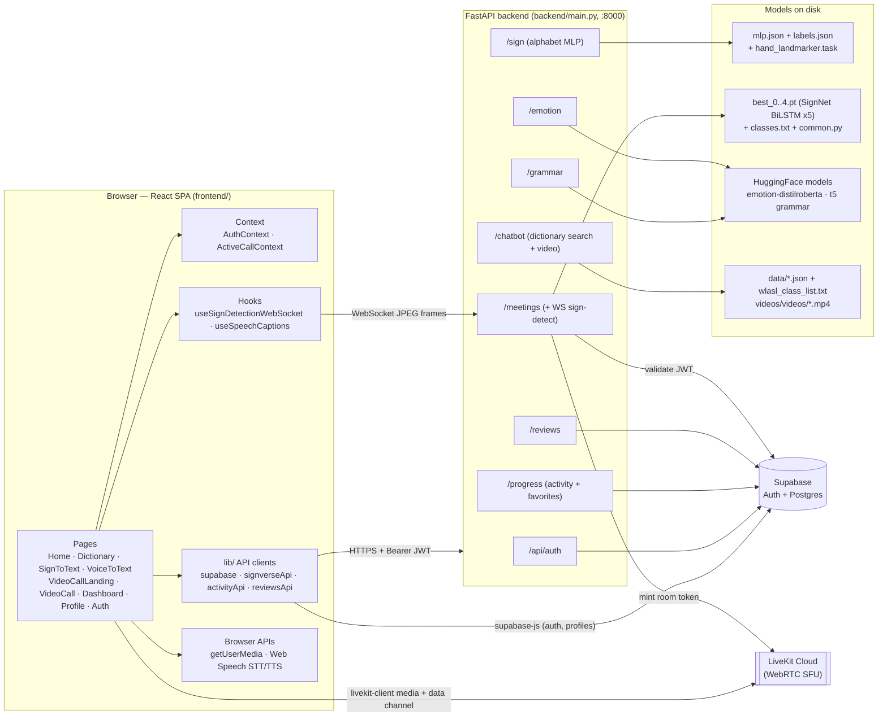
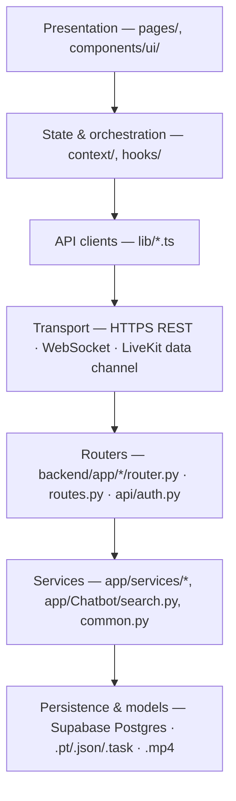
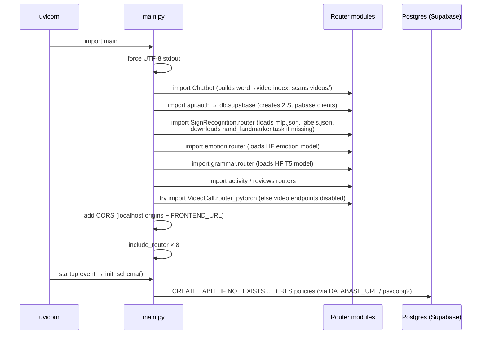
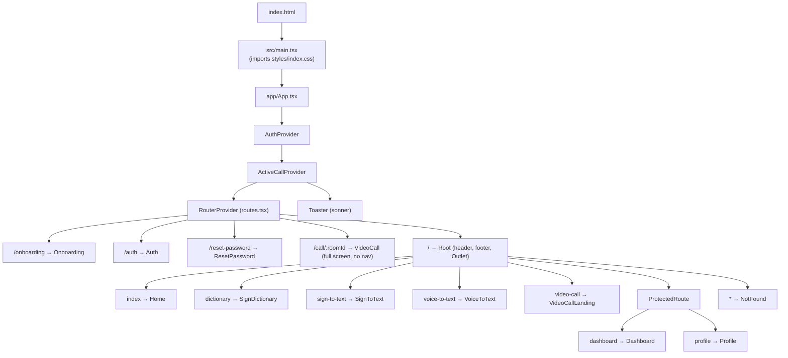
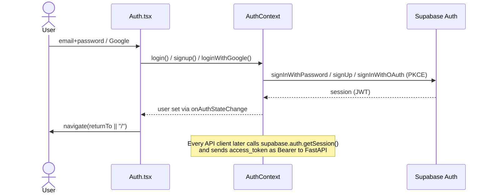
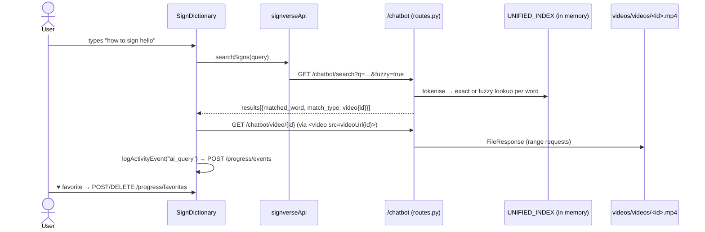
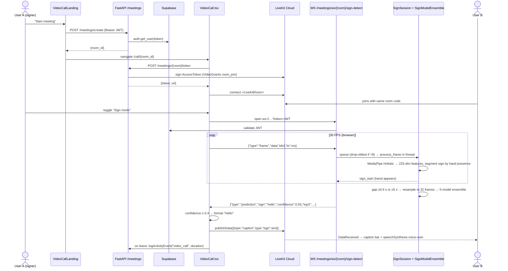
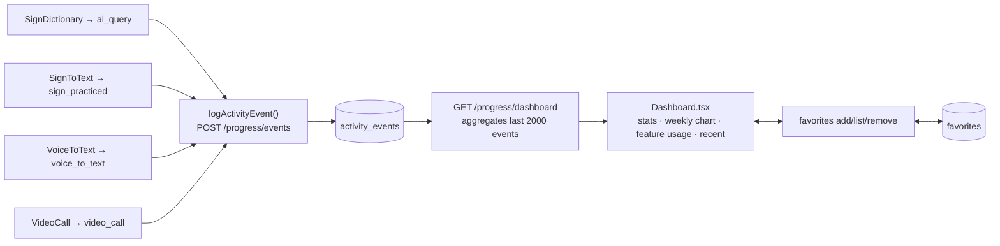
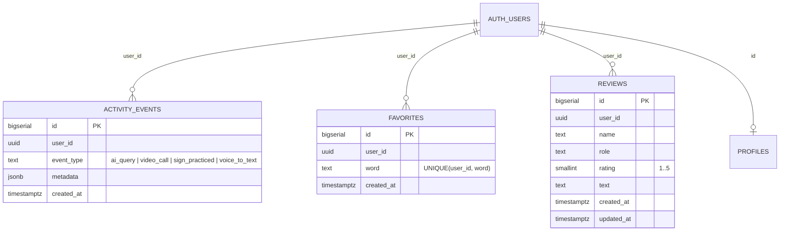

# SignTalk — Complete Project Architecture & Workflow

SignTalk is a sign-language communication platform. It has two halves:

| Half | Tech | Location | Dev port |
|------|------|----------|----------|
| **Frontend** (SPA) | React 18 + Vite + TypeScript + Tailwind, React Router 7, LiveKit client | [frontend/](./frontend) | `5173` |
| **Backend** (REST + WebSocket API) | Python 3.11, FastAPI, PyTorch, MediaPipe, HuggingFace Transformers | [backend/](./backend) | `8000` |

External services: **Supabase** (auth + Postgres), **LiveKit Cloud** (WebRTC video rooms), plus browser APIs (Web Speech recognition/synthesis, `getUserMedia`).

> Secrets are never documented here. Only variable **names** are listed (see [§9](#9-configuration--environment-variables)).

---

## Table of contents

1. [System overview diagram](#1-system-overview-diagram)
2. [Repository layout](#2-repository-layout)
3. [Backend architecture](#3-backend-architecture)
4. [Frontend architecture](#4-frontend-architecture)
5. [Feature workflows (end-to-end)](#5-feature-workflows-end-to-end)
6. [ML pipelines](#6-ml-pipelines)
7. [Database schema](#7-database-schema)
8. [API reference](#8-api-reference)
9. [Configuration & environment variables](#9-configuration--environment-variables)
10. [Build, run & deploy](#10-build-run--deploy)
11. [Legacy / unused files](#11-legacy--unused-files)

---

## 1. System overview diagram



### Layered view



---

## 2. Repository layout

```
SignTalk-master/
├── PROJECT_ARCHITECTURE.md        ← this document
├── BACKEND_DOCUMENTATION.md       ← older backend notes
├── DOCUMENTATION_INDEX.md         ← index of the older docs
├── MODELS_QUICK_REFERENCE.md      ← model-swap quick reference
├── MODEL_DEPLOYMENT_GUIDE.md      ← model deployment guide
├── FRONTEND_COMPONENT_TEMPLATE.tsx← example component template (not imported)
├── package.json (root)            ← only declares @mediapipe/tasks-vision
├── .gitignore / .gitattributes
├── backend/
│   ├── main.py                    ← FastAPI entrypoint
│   ├── common.py                  ← SignNet model + feature prep (shared by train & serve)
│   ├── extract.py                 ← training-data extractor (videos → .npz)
│   ├── verify_setup.py            ← pre-flight check for the PyTorch pipeline
│   ├── requirements.txt · Dockerfile · .Dockerignore · .env
│   ├── app/
│   │   ├── api/auth.py
│   │   ├── db/{supabase.py, schema.py}
│   │   ├── Chatbot/{__init__,routes,search,dataset_loader}.py
│   │   ├── SignRecognition/{router.py, mlp.json, labels.json, hand_landmarker.task,
│   │   │                    best_0..4.pt, classes.txt}
│   │   ├── VideoCall/{router_pytorch.py (active), router.py, router_enhanced.py (legacy)}
│   │   ├── services/{pytorch_sign_recognizer.py, pytorch_video_handler.py}
│   │   ├── emotion/router.py
│   │   ├── grammar/router.py
│   │   ├── activity/router.py
│   │   └── reviews/router.py
│   ├── data/{nslt_100,300,1000,2000}.json, wlasl_class_list.txt
│   ├── videos/videos/*.mp4        ← ~12k WLASL clips (git-ignored)
│   └── scripts/integrate_trained_model.py
└── frontend/
    ├── index.html · vite.config.ts · postcss.config.mjs · package.json · .env
    ├── public/                    ← logo, mediapipe/, tasks-vision-wasm/, models/, ort-*.wasm
    └── src/
        ├── main.tsx               ← React root
        ├── app/{App.tsx, routes.tsx}
        ├── app/pages/             ← route screens
        ├── app/components/        ← ProtectedRoute, ScrollToTop, figma/, ui/
        ├── app/context/           ← AuthContext, ActiveCallContext
        ├── app/hooks/             ← sign / speech hooks
        ├── app/types/video.ts
        ├── app/data/signData.ts
        ├── lib/                   ← API clients
        └── styles/                ← fonts, tailwind, theme, globals, index
```

---

## 3. Backend architecture

### 3.1 Startup sequence (`backend/main.py`)



Heavy models (HF, MLP) load **at import time**, so the first start can be slow and may download HuggingFace weights. Dockerfile runs **one worker** because each worker would load all models.

### 3.2 File-by-file responsibilities

| File | Role | Used by |
|------|------|---------|
| [main.py](./backend/main.py) | Creates `FastAPI` app, CORS, mounts all routers, runs `init_schema()` on startup, `GET /` health | uvicorn / Dockerfile |
| [common.py](./backend/common.py) | `classes` (from `classes.txt`), `SignNet` (2-layer BiLSTM, 128 hidden), `prep()` feature builder (pose subset + hand-shape + velocity), `augment()` for training | `services/pytorch_sign_recognizer.py`, `verify_setup.py`, training |
| [extract.py](./backend/extract.py) | Offline: MediaPipe Holistic on `dataset/{train,val,test}/<class>/*.mp4` → resample to 32 frames × 225 features → `dataset/*.npz`; writes `classes.txt` | Model training (not at runtime) |
| [verify_setup.py](./backend/verify_setup.py) | Checks model files, imports, and that all 5 `.pt` weights load | Developer pre-flight |
| [app/db/supabase.py](./backend/app/db/supabase.py) | Exposes `supabase` (anon key, RLS-respecting) and `supabase_admin` (service-role, bypasses RLS) | auth, activity, reviews, VideoCall |
| [app/db/schema.py](./backend/app/db/schema.py) | Idempotent DDL (tables, indexes, RLS policies) via `psycopg2` + `DATABASE_URL` | `main.py` startup |
| [app/api/auth.py](./backend/app/api/auth.py) | Signup / login / logout / reset-password / **delete-account** (deletes `profiles` row + auth user) | `main.py` → `/api/auth` |
| [app/Chatbot/routes.py](./backend/app/Chatbot/routes.py) | Dictionary API: search, suggest, word detail, vocab count, **video streaming** (`Accept-Ranges`). Builds index at import, keeps only words with an on-disk video, injects custom letters c/i/x/y/z | `main.py` → `/chatbot` |
| [app/Chatbot/dataset_loader.py](./backend/app/Chatbot/dataset_loader.py) | Reads `data/nslt_*.json` + `wlasl_class_list.txt` → `{word: [{id, source}]}` | `Chatbot/routes.py` |
| [app/Chatbot/search.py](./backend/app/Chatbot/search.py) | Tokenises query (strips fillers like "how to sign"), exact + `difflib` fuzzy match, prefix suggestions | `Chatbot/routes.py` |
| [app/Chatbot/\_\_init\_\_.py](./backend/app/Chatbot/__init__.py) | Re-exports `router` | `main.py` |
| [app/SignRecognition/router.py](./backend/app/SignRecognition/router.py) | **Alphabet (A–Z + Space) recognition**: base64 image → MediaPipe `HandLandmarker` → 273-feature vector → numpy MLP → label + landmarks. `GET /sign/health`, `POST /sign/predict` | `main.py` → `/sign` |
| `app/SignRecognition/mlp.json` / `labels.json` / `hand_landmarker.task` | MLP weights, label map (27 labels), MediaPipe hand model | `SignRecognition/router.py` |
| `app/SignRecognition/best_0..4.pt`, `classes.txt` | **Phrase recognition** ensemble: 5 SignNet checkpoints + 20 phrase classes | `services/*`, `VideoCall/router_pytorch.py` |
| [app/VideoCall/router_pytorch.py](./backend/app/VideoCall/router_pytorch.py) | **Active** meetings router: create room, LiveKit token, join, WebSocket `/meetings/ws/{room}/sign-detect`, `/meetings/health` | `main.py` → `/meetings` |
| [app/services/pytorch_video_handler.py](./backend/app/services/pytorch_video_handler.py) | `PyTorchVideoStreamHandler`: per-connection WebSocket loop; reader task + bounded queue (drops oldest frames); inference in worker thread; lazy-loads the ensemble | `router_pytorch.py` |
| [app/services/pytorch_sign_recognizer.py](./backend/app/services/pytorch_sign_recognizer.py) | `SignModelEnsemble` (loads `best_*.pt`, averages softmax) and `SignSession` (per-connection Holistic + sign segmenter + non-sign filter) | `pytorch_video_handler.py` |
| [app/emotion/router.py](./backend/app/emotion/router.py) | `POST /emotion/detect`: `j-hartmann/emotion-english-distilroberta-base` → label/emoji/colour/score | `main.py` → `/emotion` |
| [app/grammar/router.py](./backend/app/grammar/router.py) | `POST /grammar/correct`: pre-process (contractions) → `vennify/t5-base-grammar-correction` → post-process | `main.py` → `/grammar` |
| [app/activity/router.py](./backend/app/activity/router.py) | Event logging, Dashboard aggregation (stats, weekly minutes, feature usage, recent activity), favorites CRUD | `main.py` → `/progress` |
| [app/reviews/router.py](./backend/app/reviews/router.py) | Public testimonials + per-user review CRUD | `main.py` → `/reviews` |
| [scripts/integrate_trained_model.py](./backend/scripts/integrate_trained_model.py) | Utility for validating/versioning a trained pickle model (older sklearn-style flow) | Manual use |

### 3.3 Authentication pattern

Every protected router repeats the same dependency: read `Authorization: Bearer <JWT>` → `supabase.auth.get_user(token)` → 401 on failure. WebSockets pass the JWT as `?token=` because browsers can't set headers on `WebSocket`.

---

## 4. Frontend architecture

### 4.1 Boot & routing



`ProtectedRoute` shows a spinner while `AuthContext.isLoading`, redirects to `/auth` when there is no user, otherwise renders `<Outlet/>`.

### 4.2 Pages

| Page | Purpose | Backend / services used |
|------|---------|-------------------------|
| [Onboarding.tsx](./frontend/src/app/pages/Onboarding.tsx) | Intro slides → `/auth` | — |
| [Auth.tsx](./frontend/src/app/pages/Auth.tsx) | Login / signup / Google / forgot password; honours `?returnTo=` | `AuthContext` → Supabase |
| [ResetPassword.tsx](./frontend/src/app/pages/ResetPassword.tsx) | Set a new password from the emailed link | Supabase (`updateUser`) |
| [Root.tsx](./frontend/src/app/pages/Root.tsx) | Layout: nav, user dropdown, footer, `ScrollToTop`, `<Outlet/>` | `AuthContext` |
| [Home.tsx](./frontend/src/app/pages/Home.tsx) | Landing page, feature cards, testimonials (view/add/edit/delete own reviews) | `reviewsApi` → `/reviews` |
| [SignDictionary.tsx](./frontend/src/app/pages/SignDictionary.tsx) | Search words/sentences, A–Z alphabet, play sign videos, favorites | `signverseApi` → `/chatbot/*`; `activityApi` (`ai_query`, favorites) |
| [SignToText.tsx](./frontend/src/app/pages/SignToText.tsx) | Camera fingerspelling → letters → words → sentence; fix grammar, copy, speak | `POST /sign/predict`, `GET /sign/health`, `POST /grammar/correct`; logs `sign_practiced` |
| [VoiceToText.tsx](./frontend/src/app/pages/VoiceToText.tsx) | Live speech transcription + emotion analysis | Browser Web Speech API; `POST /emotion/detect`; logs `voice_to_text` |
| [VideoCallLanding.tsx](./frontend/src/app/pages/VideoCallLanding.tsx) | Start meeting / join by code or invite URL; shows minimized-call banner | `POST /meetings/create`; Supabase session |
| [VideoCall.tsx](./frontend/src/app/pages/VideoCall.tsx) | LiveKit room UI, captions, sign/speech modes, TTS voice-over, minimize | `POST /meetings/{room}/token`; LiveKit; logs `video_call` |
| [Dashboard.tsx](./frontend/src/app/pages/Dashboard.tsx) | Stats, weekly chart (recharts), feature usage, recent activity, favorites | `activityApi` → `/progress/*` |
| [Profile.tsx](./frontend/src/app/pages/Profile.tsx) | Edit profile (`profiles` table), change password, delete account | Supabase table `profiles`; `AuthContext.deleteAccount` → `/api/auth/delete-account` |
| [NotFound.tsx](./frontend/src/app/pages/NotFound.tsx) | 404 | — |

### 4.3 State, hooks, libs

| File | Responsibility |
|------|----------------|
| [context/AuthContext.tsx](./frontend/src/app/context/AuthContext.tsx) | Holds `user`/`session`; wraps Supabase auth (password, Google OAuth with PKCE, reset/update password); `deleteAccount` calls backend |
| [context/ActiveCallContext.tsx](./frontend/src/app/context/ActiveCallContext.tsx) | Remembers the active call (`roomId`, minimized flag) so the user can leave `/call/:id` and return |
| [hooks/useSignDetectionWebSocket.ts](./frontend/src/app/hooks/useSignDetectionWebSocket.ts) | Captures local camera frames at 30 FPS (640×480 JPEG base64), sends over WebSocket, receives `sign_start` / `prediction`, **publishes captions through the LiveKit data channel**; auto-reconnect + token refresh |
| [hooks/useSpeechCaptions.ts](./frontend/src/app/hooks/useSpeechCaptions.ts) | Browser `SpeechRecognition` → caption messages published through LiveKit |
| [types/video.ts](./frontend/src/app/types/video.ts) | `CaptionMessage` (`topic:"caption"`, `type: sign|speech`, `text`, `identity`) |
| [lib/supabase.ts](./frontend/src/lib/supabase.ts) | Single Supabase client (PKCE) |
| [lib/signverseApi.ts](./frontend/src/lib/signverseApi.ts) | `/chatbot` client: `searchSigns`, `getSuggestions`, `getWordDetail`, `videoUrl`, `healthCheck` |
| [lib/activityApi.ts](./frontend/src/lib/activityApi.ts) | `/progress` client: `logActivityEvent` (never throws), `getDashboard`, favorites |
| [lib/reviewsApi.ts](./frontend/src/lib/reviewsApi.ts) | `/reviews` client (public list, mine, add/update/delete) |

### 4.4 Components

| Component | Purpose |
|-----------|---------|
| [ProtectedRoute.tsx](./frontend/src/app/components/ProtectedRoute.tsx) | Auth gate for `/dashboard`, `/profile` |
| [ScrollToTop.tsx](./frontend/src/app/components/ScrollToTop.tsx) | Resets scroll on navigation (used in `Root`) |
| [figma/ImageWithFallback.tsx](./frontend/src/app/components/figma/ImageWithFallback.tsx) | `` with fallback (used in `Home`) |
| [ui/ParticipantVideoTile.tsx](./frontend/src/app/components/ui/ParticipantVideoTile.tsx) | One LiveKit video tile; mounts the sign + speech hooks for the **local** tile; renders caption bar, preview chip, status badges |
| [ui/CallControls.tsx](./frontend/src/app/components/ui/CallControls.tsx) + `CallEndIcon.tsx` | Mic / camera / sign mode / speech mode / minimize / leave buttons |
| [ui/MinimizedCallPreview.tsx](./frontend/src/app/components/ui/MinimizedCallPreview.tsx) | "Return to call" banner driven by `ActiveCallContext` |
| `ui/*` (shadcn/Radix) | Design-system primitives. **Used by pages:** button, card, badge, input, label, separator, textarea, tabs, switch, progress, scroll-area, dialog, alert-dialog, dropdown-menu, select, sonner. The rest are unused scaffolding. `ui/utils.ts` (`cn`) is imported by ~43 of them |

### 4.5 Styles & build config

`styles/index.css` imports `fonts.css` → `tailwind.css` (Tailwind 4 + `tw-animate-css`) → `theme.css`. `globals.css` and `frontend/default_shadcn_theme.css` are additional theme references. `vite.config.ts` registers React + Tailwind plugins, `@` → `src` alias, a `figma:asset/` resolver, and an `/api` dev proxy to `127.0.0.1:8001` (unused by current code, which calls `:8000` directly).

---

## 5. Feature workflows (end-to-end)

### 5.1 Authentication



Account deletion: `Profile` → `AuthContext.deleteAccount()` → `DELETE /api/auth/delete-account` → backend validates JWT, deletes `profiles` row, then deletes the auth user with the service-role client.

### 5.2 Sign Dictionary (text → sign videos)



Index build (at backend start): `wlasl_class_list.txt` + `nslt_*.json` → word→video IDs → filtered by files that actually exist in `videos/videos/`.

### 5.3 Sign → Text (fingerspelling, single user)

```mermaid
sequenceDiagram
    actor User
    participant P as SignToText.tsx
    participant API as POST /sign/predict
    participant MP as MediaPipe HandLandmarker
    participant MLP as numpy MLP (mlp.json)
    participant G as POST /grammar/correct
    User->>P: Start (getUserMedia 640×480)
    loop every 150 ms (one request in flight)
        P->>API: {image: dataURL JPEG}
        API->>MP: detect hand (lock-protected, 1 hand)
        MP-->>API: 21 landmarks
        API->>MLP: featurize → 273 features → softmax
        API-->>P: {hand_detected, label, confidence, landmarks}
    end
    P->>P: vote over last 8 → hold 12 frames → commit letter (cooldown 14)
    P->>P: "Space" commits word; Backspace/Enter/Esc shortcuts
    P->>API: logActivityEvent("sign_practiced") on each letter
    User->>P: "Fix grammar"
    P->>G: {text:"I HUNGRY"}
    G-->>P: {corrected:"I am hungry."}
    User->>P: Copy / Speak (SpeechSynthesis)
```

### 5.4 Voice → Text with emotion

1. `VoiceToText` starts browser `SpeechRecognition` and shows the live transcript.
2. Finalised text is sent to `POST ${VITE_API_URL}/emotion/detect`.
3. Backend returns `{code, label, emoji, color, score}`; UI renders emotion badge + `Progress` bar.
4. Session duration is logged as `voice_to_text`.

### 5.5 Video call with live sign captions (the main workflow)



Notes:
- **Inference is server-side**; only the local participant's tile runs the hook (`isLocal && signMode`).
- **Speech mode** uses `useSpeechCaptions` the same way (browser STT → LiveKit data channel). Voice-over (TTS) is played only for `type:"sign"` captions.
- Leaving the page via Back/Minimize stores the call in `ActiveCallContext`, and `VideoCallLanding` shows `MinimizedCallPreview`.
- `PyTorchVideoStreamHandler` is created per **room** and loads the ensemble lazily; each **connection** gets its own `SignSession` (own Holistic + buffer) so participants never mix.

### 5.6 Dashboard & activity tracking



The router path is deliberately named `/progress` (not "activity") because ad-blockers block such URLs.

### 5.7 Reviews

`Home.tsx` → `getPublicReviews()` (no auth) → `GET /reviews/public`. Signed-in users add/edit/delete their own reviews; the backend resolves the display name from `profiles.name` → Supabase metadata → email prefix.

---

## 6. ML pipelines

### 6.1 Alphabet recognition (`/sign/predict`)

```
JPEG → OpenCV decode → MediaPipe HandLandmarker (1 hand)
     → coords - wrist, ÷ ‖landmark9‖ → 63 coords + 210 pairwise distances = 273
     → MLP (3 dense layers, ReLU, softmax; weights from mlp.json)
     → A–Z or "Space"
```
The frontend does temporal smoothing/hold logic; the server is stateless.

### 6.2 Phrase recognition (video call)

```
Browser JPEG @30 FPS → WebSocket → Holistic (pose 33 + hands 2×21) → 225 features/frame
   normalise: centre on shoulder midpoint, scale by shoulder width
   segment: start at first hand frame; end after 0.6 s without hands (or 5 s max)
   filters: < 0.3 s / < 4 frames → "too_short";  wrist resting low or no motion → "not_signing"
   resample to 32 frames evenly in TIME → common.prep():
        select 11 pose joints + hand landmarks + hand-shape (wrist-relative) + frame deltas
   → 5 × SignNet (BiLSTM 2×128, mean-pool, dropout, linear) → average softmax → top-3
```
20 classes: bye, good_morning, hello, how_are_you, i_am_busy, i_am_fine, i_cant_hear_you, i_dont_know, i_know, i_need_help, i_understand, nice_to_meet_you, no_sign, no_thankyou, same_here, see_you_later, take_care, what_is_your_name, whats_up, yes_please.

Training flow (offline): `extract.py` (videos → `.npz`) → train with `common.augment/prep/SignNet` → `best_0..4.pt` + `classes.txt` into `app/SignRecognition/` → run `verify_setup.py`.

Tunable env vars: `MIN_SIGN_SECONDS`, `MAX_SIGN_SECONDS`, `END_GAP_SECONDS`, `MIN_SIGN_FRAMES`, `HOLISTIC_MIN_DETECTION`, `HOLISTIC_MIN_TRACKING`, `FILTER_NON_SIGNS`, `SIGNING_ZONE_MAX_Y`, `MIN_ZONE_FRACTION`, `MIN_MOTION`, `TORCH_THREADS`, `SAVE_SEGMENTS_DIR`.

### 6.3 Text models

| Endpoint | Model | Notes |
|----------|-------|-------|
| `/emotion/detect` | `j-hartmann/emotion-english-distilroberta-base` | 7 emotions, CPU |
| `/grammar/correct` | `vennify/t5-base-grammar-correction` | lower-cases input, expands contractions ("im"→"i am"), beam search 4 |

---

## 7. Database schema

Created automatically by `init_schema()` (requires `DATABASE_URL`). Auth users and the `profiles` table are managed by Supabase / the dashboard.



RLS: `activity_events` and `favorites` are owner-only; `reviews` are publicly readable and owner-writable. The backend uses the service-role client for these tables (bypasses RLS) and filters by the verified `user_id` itself.

---

## 8. API reference

| Method | Path | Auth | Purpose |
|--------|------|------|---------|
| GET | `/` | – | Liveness |
| POST | `/api/auth/signup` · `/login` · `/logout` · `/reset-password` | – | Supabase auth proxy |
| DELETE | `/api/auth/delete-account` | Bearer | Delete profile + user |
| GET | `/chatbot/health` · `/vocab/count` | – | Index stats |
| GET | `/chatbot/search?q=&fuzzy=` · `/suggest?q=&limit=` · `/word/{word}` | – | Dictionary lookup |
| GET | `/chatbot/video/{video_id}` | – | Stream mp4 |
| GET | `/sign/health` | – | Alphabet labels |
| POST | `/sign/predict` | – | Image(s) → letter |
| POST | `/grammar/correct` | – | Sentence cleanup |
| POST | `/emotion/detect` | – | Text emotion |
| POST | `/progress/events` | Bearer | Log activity |
| GET | `/progress/dashboard` | Bearer | Aggregated stats |
| GET/POST/DELETE | `/progress/favorites[/{word}]` | Bearer | Favorites |
| GET | `/reviews/public` | – | Latest reviews |
| GET/POST | `/reviews/mine` · `/reviews` | Bearer | Own reviews / create |
| PUT/DELETE | `/reviews/{id}` | Bearer | Edit / delete own |
| POST | `/meetings/create` | Bearer | New room id |
| POST | `/meetings/{room}/token` · `/join` | Bearer | LiveKit join token |
| WS | `/meetings/ws/{room}/sign-detect?token=` | JWT in query | Live phrase recognition |
| GET | `/meetings/health` | – | Models/device check |

WebSocket protocol — client→server: `{"type":"frame","data":<b64 jpeg>,"ts":<ms>,"seq":n}` or `{"type":"close"}`. Server→client: `{"type":"sign_start"}` and `{"type":"prediction","sign","confidence","top3","processing_time_ms","num_frames","reason","hand_detected",…}`.

---

## 9. Configuration & environment variables

**backend/.env** (names only): `SUPABASE_URL`, `SUPABASE_KEY` (anon), `SUPABASE_SERVICE_ROLE_KEY`, `DATABASE_URL` (Postgres URI for schema init), `LIVEKIT_URL`, `LIVEKIT_API_KEY`, `LIVEKIT_API_SECRET`, optional `FRONTEND_URL` (comma-separated production origins for CORS), `PORT`, plus the sign-tuning variables in §6.2.

**frontend/.env**: `VITE_BACKEND_URL`, `VITE_API_URL` (both → backend), `VITE_LIVEKIT_URL`, `VITE_SUPABASE_URL`, `VITE_SUPABASE_ANON_KEY`.

> Several frontend files hard-code `http://localhost:8000` / `ws://localhost:8000` (`SignToText`, `VideoCall`, `VideoCallLanding`, `useSignDetectionWebSocket`). Replace them with `VITE_BACKEND_URL` before deploying.
> Both `.env` files are in `.gitignore`; keep real secrets out of version control.

---

## 10. Build, run & deploy

```powershell
# Backend (Python 3.11)
cd backend
pip install torch --index-url https://download.pytorch.org/whl/cpu
pip install -r requirements.txt
python verify_setup.py          # optional pre-flight
python main.py                  # or: uvicorn main:app --reload --port 8000

# Frontend
cd frontend
npm install
npm run dev                     # http://localhost:5173
npm run build                   # production bundle
```

- **Docker/Render:** `backend/Dockerfile` (python:3.11-slim + OpenCV/MediaPipe system libs + CPU PyTorch, single uvicorn worker on `$PORT`).
- **CORS:** localhost ports `5173/5174/3000/5001` are allowed by default; set `FRONTEND_URL` for deployed frontends.
- **Large assets:** `backend/videos/` is git-ignored (multi-GB); the dictionary only lists words whose `.mp4` exists on disk.

---

## 11. Legacy / unused files

| File | Status |
|------|--------|
| `backend/app/VideoCall/router.py` | Original meetings router (create/token/join only). Superseded by `router_pytorch.py`; not imported by `main.py` |
| `backend/app/VideoCall/router_enhanced.py` | Imports `app.services.video_stream_handler` and `model_manager`, which **do not exist** — cannot be imported |
| `backend/scripts/integrate_trained_model.py` | Pickle/sklearn-era utility; not part of the PyTorch runtime |
| `frontend/src/app/hooks/useSignCaptions.ts` | Older client-side MediaPipe + Flask (`:5001`) word classifier; no importer. Only it uses `public/tasks-vision-wasm/` and `public/models/hand_landmarker.task` |
| `frontend/src/app/hooks/useSpeechEmotion.ts` | Calls HuggingFace Inference API directly; not imported |
| `frontend/src/app/data/signData.ts` | Static sign data; not imported |
| `frontend/public/mediapipe/`, `public/ort-*.wasm` | Static assets; no references in `src/` |
| `frontend/src/app/components/ui/*` (unlisted in §4.4) | Unused shadcn scaffolding |
| `FRONTEND_COMPONENT_TEMPLATE.tsx` | Documentation template, not part of the build |
| `vite.config.ts` `/api` proxy (→ `:8001`) | Not used by current code |
